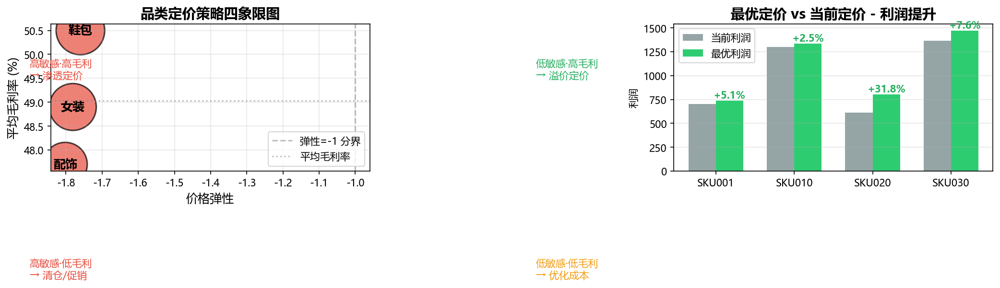

# 电商价格策略与销量预测分析

基于18,300条模拟电商销售数据，通过价格弹性分析、销量预测与利润最优化，
输出分品类定价策略，挖掘 **2.5%~31.8%** 的利润提升空间。

## 核心结论

| 指标 | 值 |
|------|-----|
| 整体价格弹性 | **-1.787**（高度敏感）|
| 销量预测 R² | **0.957** |
| 销量预测 MAPE | 17.6% |
| 价格对销量贡献 | 98.1% |
| 最优定价利润提升 | 2.5% ~ 31.8% |

## 技术栈
- **SQL（SQLite）**：多表JOIN、窗口函数（LAG/RANK/移动平均）、CTE、异常值检测
- **Python**：Pandas、Statsmodels（OLS）、Scikit-learn（随机森林）
- **可视化**：Matplotlib

## 核心方法
1. **价格弹性**：双对数OLS回归 `log(销量) ~ log(价格) + 折扣 + 竞品价`
2. **销量预测**：随机森林回归，R²=0.957，MAPE=17.6%
3. **利润最优化**：基于预测模型网格搜索最优价格点

## 核心展示


## 目录结构
price-optimization/

├── README.md

├── requirements.txt

├── run_all.sh / run_all.bat

├── data/

│ ├── raw/ # 原始5张表

│ └── processed/ # SQL整合后的宽表

├── sql/ # 建表、ETL、异常值检测

├── src/ # 8个Python脚本

└── outputs/

├── figures/ # 核心图表

├── *.csv # 结果数据

└── 项目结论.md


## 如何运行

### 环境要求
- Python 3.8+
- 依赖见 requirements.txt

### 安装
```bash
pip install -r requirements.txt